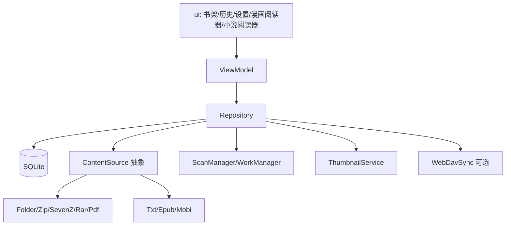

# Inkvol 完整方案 v2.1（冻结版）

> 项目：Inkvol · 本地漫画 + 小说阅读器
> 包名：`com.inkvol.app`
> 定位：纯本地、零网络（同步可选）、漫画与小说双引擎的世界级阅读器，Google Play 上架
> 设计依据：`设计规范.md`（SSMH 液态玻璃体系全文）+ 新增 §13 阅读器专章
> 状态：决策冻结；M0 已落地可构建骨架，按 §15 里程碑推进

---

## 0. 决策总表

| 维度 | 最终结论 |
|---|---|
| 名称/包名 | Inkvol（Ink + Volume），`com.inkvol.app` |
| 视觉 | SSMH 玻璃体系整目录平移 + GlassRail 侧栏 + 横竖屏适配 |
| 信息架构 | 3 Tab：书架 / 历史 / 设置；书架内 全部·漫画·小说 类型 chips |
| 导入 | 默认托管文件夹（SAF），另留复制入库 / 单次打开 |
| 漫画格式 | 文件夹散页 / ZIP·CBZ / 7z·CB7 / PDF / RAR4·CBR / RAR5 |
| 小说格式 | TXT + EPUB 核心；PDF 走固定版式；MOBI/AZW3（非 DRM）M6.4 |
| 书架 | 系列聚合卡（默认）+ 平铺视图；多书库 |
| 阅读器 | SSMH 引擎 + 九宫格手势 + 快捷面板 + 零延迟翻页 |
| 同步 | 坚果云 WebDAV（可选，默认关闭，M4.5） |
| 上架 | 零存储权限、targetSdk 37、16KB page、arm64 |

---

## 1. 产品原则（不可妥协）

1. **纯本地**：不采集、不上传；主界面无在线入口；同步仅在用户主动配置后启用。
2. **零延迟**：翻页不等待、连翻不排队、放大不模糊、打开即见。
3. **数据永不丢**：进度节流落盘、删除进回收站、备份版本化、崩溃可恢复。
4. **三击原则**：导入、继续阅读、找书、改设置 ≤ 3 次点击。
5. **手势有可见替代**：手势只是加速器，按钮永远存在。
6. **阅读器零打断**：所有提示/设置/错误都在页内面板或气泡解决。
7. **返回有来处**：滚动位置、筛选、页码、阅读位置全部保留。

---

## 2. 信息架构

```
底部 Tab（宿主满宽玻璃底栏）
├── 书架（默认）
│   ├── 类型 chips：全部 / 漫画 / 小说
│   ├── 继续阅读 + 接下来读（On Deck）+ 最近添加
│   ├── 智能书架 chips（未读/在读/读完/收藏/有书签/标签）
│   └── 全库网格：系列卡 / 平铺 / 层板
├── 历史（漫画页码 / 小说章节混排）
└── 设置（8 组）

二级页
├── 系列详情（卷/话列表 + 继续阅读）
├── 漫画阅读器 / 小说阅读器
├── 书库地图 / 注释浏览器 / 统计 / 回收站 / 重复检测
└── 导入向导 / 书库管理 / 同步设置
```

---

## 3. 技术架构

### 3.1 技术栈

Kotlin 2.3.21 + Jetpack Compose（BOM 2026.09.00）+ Material3 1.4.0；AGP 9.4.1；JDK 17；compileSdk/targetSdk 37、minSdk 26；DataStore + SQLite（WAL）；Coil 3；WorkManager / Glance 按版本引入；manual DI（沿用 SSMH ViewModel initializer）。

玻璃依赖：`io.github.kyant0:backdrop` 2.0.1 + `io.github.kyant0:shapes` 1.2.1。

### 3.2 分层



### 3.3 核心接口

```kotlin
interface BookContentSource : Closeable {        // 漫画
    val pageCount: Int
    fun listPages(): List<PageRef>
    fun openPage(index: Int): InputStream
    fun openRegion(index: Int, rect: Rect): Bitmap?
}

interface NovelSource : Closeable {              // 小说
    val chapterCount: Int
    fun listChapters(): List<ChapterRef>
    fun openChapter(index: Int): BookContent     // 受限块模型
}
```

安全：entry 名禁 `..`；解压体积/条目上限；加密包统一错误；临时目录按指纹隔离并 LRU 清理。

### 3.4 线程模型

扫描并发 2、缩略图并发 2、解码并发 2；DB 单写 + Mutex；阅读器解码 IO、绘制主线程、预取带代次可取消。

---

## 4. 数据模型

```sql
libraries(id, name, type /*COMIC|NOVEL|MIXED*/, rootTreeUri, scanDepth, hidden, createdAt, sortKey)
folders(id, libraryId, treeUri, displayName, lastScanAt, enabled, offline, lastError)
books(id TEXT PK /*fingerprint*/, type, title, series, volume, number, writer, tags,
      pageCount, chapterCount, format, fileSize, coverPageIndex, coverPath,
      language, ageRating, readStatus /*WANT|READING|FINISHED*/, addedAt, updatedAt)
book_locations(bookId, folderId, docId, displayPath, lastSeenAt, isPrimary,
               PRIMARY KEY(bookId, docId))
book_settings(bookId PK, settingsJson)   -- 漫画/小说共用，JSON 可扩展
progress(bookId PK, page, chapterIdx, charOffset, percent, finished,
         sessionSeconds, updatedAt)
history(id, bookId, openedAt, lastPage, chapterIdx)
page_bookmarks(bookId, pageIndex, createdAt, note)
reading_lists(id, name, sortKey) + reading_list_items(listId, bookId, sortKey)
collections(id, name) + collection_items(collectionId, bookId)
smart_filters(id, name, conditionJson, pinned, sortKey)
trash(bookId, deletedAt, snapshotJson)
scan_tasks(id, libraryId, startedAt, finishedAt, added, removed, changed, status)

-- 小说扩展
novel_chapters(bookId, idx, title, href, byteStart, byteEnd, charCount)
novel_highlights(bookId, chapterIdx, startOffset, endOffset, color, note, snippet, createdAt)
novel_bookmarks(bookId, chapterIdx, charOffset, snippet, note, createdAt)
novel_fts(bookId, chapterIdx, text)          -- SQLite FTS4
novel_vocab(word, reading, definition, addedAt, nextReviewAt, stage)
```

关键语义：

- **身份 = 内容指纹**（size + 头 64KB + 中段 64KB + 尾 64KB 的 SHA-256），与路径无关；多 location，全消失才进回收站。
- **漫画进度 = 页号**；**小说进度 = 章节 + 字符偏移**（字号/行距/横竖屏不漂移）。
- **移出书架 ≠ 删除文件**；删除文件进回收站 30 天。
- **元数据本地覆盖**，不写回归档。
- 同书换文件（指纹变化、用户选择替换）时，按百分比映射页码/字符偏移并 clamp，不静默归零。

---

## 5. 导入系统

### 5.1 三语义

| 语义 | 行为 | 默认 |
|---|---|---|
| 托管文件夹 | SAF 持久授权，只索引不搬文件 | 是 |
| 复制入库 | 拷入 `filesDir/library/` | 可选 |
| 单次打开 | 不入库只阅读 | 分享入口 |

### 5.2 格式矩阵

| 格式 | 实现 | 备注 |
|---|---|---|
| 文件夹散页 | 目录列举 + 自然排序 | jpg/png/webp/bmp/gif 首帧 |
| ZIP/CBZ | `ZipFile` 随机访问 | 文件名编码嗅探 |
| 7z/CB7 | commons-compress + XZ | 加密包报错 |
| RAR4/CBR | junrar | 纯 Java |
| RAR5 | 官方 unrar JNI | NDK r27+、16KB page、附许可 |
| PDF | PdfRenderer | 固定版式 |
| TXT | 流式分章 | 编码嗅探 + 章节正则 |
| EPUB | 自研解析 | 受限块模型 |
| MOBI/AZW3 | M6.4 非 DRM | 失败明确提示 |

格式识别用 magic bytes，不信任扩展名。

### 5.3 目录语义

1. 含图片目录 = 一本；2. 只含子目录 = 系列容器；3. 混合目录 = 图片一本 + 子目录各一本；4. 归档 = 一本；5. 深度上限 3；6. 忽略 `__MACOSX`/隐藏/空目录。

### 5.4 扫描流水线

```
授权 → DocumentsContract 批量 query（单 Cursor）→ 指纹 → Probe（页数/章数/首页/ComicInfo）
→ 写 books/locations → 封面队列 → 书架增量刷新
```

- WorkManager 唯一任务：可取消、断点、进度通知；长任务声明 `dataSync` 类型。
- 启动只读 DB 秒开 + 后台 diff；新增/消失/变更三类。
- 禁用 DocumentFile 递归（逐条 Binder IPC）。

### 5.5 元数据与错误

- ComicInfo.xml（Anansi，44 字段）优先；EPUB OPF；TXT 文件名解析；解析存疑（>20% 失败）才弹批量修正页；TXT 无封面用 Canvas 生成排版封面。
- 错误分类：损坏包 / 加密包 / 权限失效 / 文件已删 / 格式不支持 / 内存不足；坏页跳过不整本失败。

---

## 6. 书架与书库

- 书架：继续阅读大卡、接下来读、最近添加、类型 chips、智能书架 chips、三视图。
- 交互：下拉 = 增量扫描；长按下拉 = 全量重建；搜索即输即搜。
- 系列详情：封面 + 作者/标签 + 总进度；主按钮「继续阅读 · 第 3 卷 P12」；章列表当前高亮。
- 管理：多书库（独立根/深度/隐藏库生物识别）、智能筛选（可保存并固定 chips）、阅读列表/合集、批量元数据、重复检测（文件级 + 书内重复页）、回收站 30 天、阅读状态三档。
- 多选三档：移出书架（可撤销）/ 移入书夹 / 删除源文件（二次确认 + 回收站）。

---

## 7. 漫画阅读器

### 7.1 引擎复用

RTL/LTR/竖滚/纵向分页、横屏自动双页、封面单页、跨页横图独占、旋转保位、双页整体缩放、全屏常亮系统栏，全部从 SSMH 平移。

### 7.2 手势

| 手势 | 默认 | 可配 |
|---|---|---|
| 九宫格单击 | 左/右翻页、中显隐 | 每区可选：上/下一页、菜单、快捷面板、收藏、无（RTL 镜像） |
| 四角 | 无 | 可绑任意动作 |
| 双击 | 仅中心区放大↔还原 2.0x | 动作 6 档、倍率 1.5~4.0x、区域（中心/全区）、锚点（点击点/中心） |
| 捏合 | 1x↔最大 4x，放大后拖动 | 开关、最大倍率、放大后拖动 |
| 双指单击 | 快捷面板 | 面板/菜单/无 |
| 长按 | 快捷面板；长按后拖动=放大镜 | 菜单/保存/分享/收藏此页/无 |
| 边缘上下滑 | 左亮度、右色温 | 可分别关闭 |
| 音量键 | 翻页 | 翻页/反转/音量/关闭 |

### 7.3 零延迟

```
L1 Bitmap LRU：4 页 × 屏幕分辨率
L2 归档抽取缓存：200MB，按指纹
L3 按需解码：inSampleSize 按屏；放大用 BitmapRegionDecoder 区域解码
预取 ±2，停歇补 ±4；beyondViewportPageCount=2
快翻泵：250ms 内连点取消动画改 scrollToPage，停手 300ms 恢复
```

### 7.4 快捷面板

三入口（顶栏齿轮 / 长按 / 双指）；页内模式 C（GlassRounded 16 / StrongBlur / Outline / 宽 ≤560 / 高 ≤60%）；内容：作用域芯片（仅本书/全部）+ 三状态瓦片 + 亮度/色温滑杆 + 开关行 + 恢复默认/全部设置。

### 7.5 强化能力

| 能力 | 规则 |
|---|---|
| R1 跨页自动切割 | 竖屏单页、宽高比 >1.3 自动切两页；可关、per-book；横屏双页不切 |
| R2 自动裁白边 | 投影法 + 背景色估计；per-book；结果缓存 |
| R3 无损分块放大 | >1.5x 用 BitmapRegionDecoder 按视口解原图 |
| R4 智能分格 | 投影法分格 + 阅读顺序；仅规整分格，出血/斜分格降级整页 |
| R5 放大镜 | 长按后拖动；圆角矩形视口，形状（横向 / 竖向）、尺寸（长边 = 页宽 × 0.72/0.86/0.95）、倍率（1.8/2.0/2.5x）设置页可调，横竖同口径只转 90°；四方向避让且绝不遮挡手指（空间不足等比缩小），贴页边源窗口对齐补偿，双页/分格/条漫按当前页矩形自适应 |
| R6 页面重叠 | 竖向 8~24px（先技术验证，不达标砍） |
| R7 扫描件修复 | 对比度/白平衡/去黄，开关+强度 |
| 配置档 | 白天/夜间/条漫/双页 一键切换 |
| 末页 | 页内「下一卷」卡，不弹窗 |

### 7.6 手势冲突矩阵

| 冲突对 | 判定规则 |
|---|---|
| 边缘上下滑 vs 系统返回 | 仅 `dy > dx` 且 `dy > slop` 判亮度/色温，否则让给系统 |
| 边缘滑 vs 左区单击 | 屏幕最外 20dp 起 + 垂直位移主导 → 边缘滑；位移 < slop 短按 → 单击 |
| 长按 vs 长按拖动 | 长按抬起位移 < slop → 面板；> slop → 放大镜 |
| 双击 vs 单击 | 中心区启用 280ms 双击检测；左右区默认关闭（零延迟） |
| 捏合 vs 翻页 | 双指时 transformable 接管；未放大不挂载 |
| 双指单击 vs 捏合 | 位移 < slop 且 <300ms → 双指单击 |
| 音量键 | 阅读器内拦截，可关，退出恢复 |
| 面板 vs 边缘滑 | 面板打开时边缘滑暂停 |
| 九宫格 vs chrome 按钮 | 按钮区优先命中，不触发翻页 |

---

## 8. 小说阅读器

### 8.1 格式与解析

| 格式 | 解析 |
|---|---|
| TXT | 编码嗅探（BOM→UTF-8→GB18030→UTF-16）→ UTF-8 临时文件 → 章节字节区间；正则预设 + 自定义实时预览；100MB 流式 |
| EPUB | container.xml → OPF → spine → XHTML；受限块模型；图片抽取；脚注 noteref |
| PDF | 固定版式，按页进度 |
| MOBI/AZW3 | M6.4 非 DRM，文本抽取 |

### 8.2 排版引擎

- 不用 WebView；自研块模型（Paragraph/Heading/Image/Blockquote/List/Hr/Ruby）+ TextMeasurer 分页缓存。
- 缓存键 `(bookId, chapterIdx, 字号, 行距, 视口)`；改设置防抖重排并锚定字符偏移。
- 只渲染当前章 ±1；EPUB 章节缓存 JSON。
- 平板横屏双栏/双页，复用横竖屏保位。
- **EPUB 降级三级**：L1 完整块模型；L2 复杂结构降纯文本；L3 纯文本 + 顶部提示条（可不再提示）。降级只丢样式、不丢文字；CSS 仅白名单属性。

### 8.3 界面与手势

顶栏（返回/书名/目录/搜索/更多）+ 正文 + 页码 + 底栏（章节刻度进度条 / 第X章 38% / Aa / 主题 / 更多）。

| 手势 | 小说默认 |
|---|---|
| 单击左/右/中 | 上/下一页、显隐 |
| 长按 | 选词（不是面板） |
| 双击 | 快捷面板（不缩放） |
| 双指单击 | 快捷面板 |
| 边缘滑 / 音量键 | 亮度色温 / 翻页 |
| 九宫格 | 共用配置 |

快捷面板：字号、行距、段距、首行缩进、页边距、主题/纹理、翻页方式、自动滚动速度、亮度/色温、简繁、净化开关、作用域。

### 8.4 主题与增强

主题：纸白 / 米黄 / 羊皮 / 护眼绿 / 墨黑 / 跟随系统；含文字色、页眉页脚、状态栏图标明暗；与 App 主题解耦，退出恢复；正文区禁玻璃。

| 能力 | 说明 |
|---|---|
| N1 净化规则 | 正则删除/替换，全局+每本，原文对照预览，规则导入导出 JSON，按规则版本缓存 |
| N2 书库地图 | 章节条形图（字数/已读/当前位置）+ 当前章页缩略，全屏页 |
| N3 书签/注释浏览器 | 统一列表、按章分组、搜索、编辑、跳转 |
| N4 注释导出 | Markdown / CSV / HTML |
| N5 生词本 | 查词入库 + 间隔重复 1/3/7/15/30 天 + 复习卡 |
| N6 TTS | 系统 TTS 多音色/语速/音调 + MediaSession 锁屏控制 + 按句高亮 + 断点续听 + 定时停止 |
| N7 简繁转换 | OpenCC 字表，全局+每本 |
| N8 阅读状态 | 想读/在读/读完 + 筛选 + 自动流转 |
| 其他 | 背景纹理、章节刻度进度条、跳到章节/百分比/页码、剩余时间、久读提醒、引用卡片、脚注气泡、内嵌图放大、章末下一章内联卡 |

TTS 合规：`foregroundServiceType="mediaPlayback"` + `FOREGROUND_SERVICE_MEDIA_PLAYBACK`，必须由用户点击「朗读」显式启动。

---

## 9. 设置页（8 组）

外观 / 书架 / 阅读器（漫画）/ 小说阅读 / 导入与书库 / 存储与备份 / 隐私与安全 / 关于与诊断。全部走声明式 SettingSpec DSL，选择弹窗用页内模式 A/B，无二级嵌套对话框。

---

## 10. 设计规范执行

- 玻璃仅 `GlassSurface/GlassRounded/GlassCapsule`，参数查 §2.3。
- 侧栏 GlassRail：宽 52 / 圆角 30；平板=顶部动作槽（导入·重扫·回顶）+ 底部导航，手机横屏=仅底部导航；导航高度按项数动态计算；railEndInset 66、常驻不隐显。
- 覆盖层三模式 A/B/C，禁 Dialog/BottomSheet/Popup 独立窗口。
- 页面玻璃只挂页面级 backdrop。
- 深浅双套 + Full/Lite/None 三档目检。
- 新增 §13 阅读器章：§13.1 漫画（全屏 chrome、页数条、气泡、放大器）；§13.2 小说（正文禁玻璃、目录/地图/注释走模式 C、词典脚注锚定气泡、主题与状态栏联动、字号实时生效不关面板）。
- 每批过 §12 自检 13 条 + 附录 A 矩阵（手机竖/横、平板侧栏、深浅、三档能力、分屏/小窗/折叠）。

---

## 11. 操作逻辑规范

| 场景 | 规则 |
|---|---|
| 首启 | 欢迎页单主按钮选文件夹 + 行内 18+ 勾选 + 骨架屏进度胶囊 |
| 分享打开 | 三选一 + 记住选择 |
| 重复导入 | 静默关联新位置 |
| 大目录 | 自动开始，仅 >20% 解析存疑才弹修正页 |
| 扫描 | 顶部进度胶囊，可取消，可继续浏览 |
| 权限失效 | 书架横幅「离线 · 重新授权」 |
| 多选 | 触觉 + 顶栏切换 + 底部玻璃条 |
| 删除 | Snackbar 撤销 5s；删源文件才确认 |
| 阅读器 | 进入直落页 + 页码浮出 1.2s；退出不确认；末页「下一卷/下一章」页内卡 |
| 文件被删 | 页内提示 + 移出书架/重试，不闪退 |
| 备份恢复 | 预检可匹配/缺文件 + 定位文件夹 |
| 设置 | 右侧显示当前值，单击开模式 A，无二级嵌套；危险项红色确认 |

---

## 12. 同步（M4.5）

- 坚果云 WebDAV：`https://dav.jianguoyun.com/dav/` + 应用密码（Basic Auth）。
- 限制：免费 600 请求/30min、单文件 500MB、PROPFIND 单次 750 项分页、偶发 503。
- **每设备只写 `/Inkvol/devices/<deviceId>.json`**，读其它设备合并，无写冲突。
- 内容：进度、状态、时长、书签、划线笔记、per-book 设置、元数据覆盖、墓碑。
- 合并：LWW + 墓碑 30 天 + 进度取更靠后。
- 触发：手动 + 进度保存防抖 2min + 退后台；可仅 WiFi。
- 备选：SAF 同步文件夹（零网络权限，依赖坚果云客户端）。
- 安全：应用密码 Keystore 加密；HTTPS；可选用口令加密同步文件；`INTERNET` 默认关闭、仅访问用户指定服务器。

---

## 13. 上架合规

| 项 | 要求 |
|---|---|
| 权限 | 零存储权限；SAF 导入；导出走 MediaStore；通知/生物识别按需；WorkManager 声明 dataSync FGS；`INTERNET` 仅同步 |
| 原生 | targetSdk 37；16KB page（NDK r27+）；arm64 + x86_64 |
| 许可 | junrar/commons-compress（Apache-2.0）、XZ（Public Domain）、unRAR（附许可）、OpenCC（Apache-2.0）、思源宋体（OFL） |
| 商店 | Play App Signing、隐私政策、Data Safety 不收集、内容分级、中英双语 |
| 无障碍 | TalkBack 标签、放大字体、高对比主题、48dp 触控、朗读模式；不做高级档 |

---

## 14. 性能 SLO

| 指标 | 目标 |
|---|---|
| 冷启动到书架（缓存） | ≤ 800ms（配合 Baseline Profiles） |
| 漫画首帧 | 命中 ≤400ms；首次 ≤1.2s |
| 翻页 | 掉帧 ≤1 帧，P95 ≤16ms；连翻不排队 |
| 小说 TXT 打开 | 100 万字 ≤1s；章内分页 ≤80ms |
| 改字号保位 | 误差 ≤1 段 |
| 全文搜索 | ≤200ms |
| 扫描 1000 本 | 增量 ≤2s；全量后台 ≤3min |
| 阅读器内存 | ≤250MB；100MP 图不 OOM |

---

## 15. 里程碑与版本切分

| 版本 | 范围 | 目标 |
|---|---|---|
| **v1.0（MVP）** | M0 骨架 → M0.5 spike → M1 导入 → M2 书架 → M3 漫画阅读器 + R1/R2 | 可上架核心闭环 |
| **v1.1** | M3.5 其余（R3/R5/R6/R7/配置档）+ M4（统计/Widget/分享/备份增强） | 阅读体验完整 |
| **v1.2** | M4.5 坚果云同步 | 多设备进度 |
| **v2.0** | M5 智能分格 + M6.1 TXT + M6.2 EPUB + M6.3 划线/搜索/地图/净化/统计 | 小说核心闭环 |
| **v2.1** | M6.4（MOBI/AZW3、词典生词本、TTS、简繁、引用卡） | 全量能力 |

### 验收补充

| 项 | 验收 |
|---|---|
| R4 分格 | 规整分格 ≥90%；出血/斜分格降级整页 |
| R6 重叠 | 先技术验证，不达标砍 |
| 分页引擎 | TextMeasurer vs StaticLayout 对比选优 |
| 指纹 | 三采样（头/中/尾 64KB） |
| 换文件 | 百分比映射 + clamp |
| 窗口形态 | 分屏/小窗/折叠布局不破版 |

---

## 16. 风险与对策

| 风险 | 对策 |
|---|---|
| unRAR 16KB 卡上架 | M0.5 spike 验证，`readelf` 核对对齐 |
| 分格误判 | 面板外点击退出，限定规整分格 |
| SAF 云盘慢/断 | 超时与错误分类、离线角标、重新授权 |
| 大图 OOM | 区域解码 + onTrimMemory |
| MIUI 后台限制 | 前台通知 + 电池优化引导 |
| 页面重叠不稳 | 失败回落 0 间距 |
| 净化误删正文 | 强制预览对照 + 规则级开关 |
| MOBI/AZW3 解析 | 先文本抽取，失败提示；DRM 不碰 |

---

## 17. 明确不做

在线源/OPDS、在线翻译、AI 上色/超分、账号云服务、改写归档内文件、竖排排版、OCR、DRM 破解、页卷曲仿真（仅 M6.4 评估）。

---

## 18. 开工清单

1. 新建工程 `com.inkvol.app`（已完成 M0 骨架）。
2. 平移玻璃体系与宿主 chrome（已完成）。
3. 三 Tab 与类型 chips 占位（已完成）。
4. M0.5 四项 spike：RAR5 JNI+16KB、SAF 批量扫描、归档解码、PdfRenderer。
5. M1 导入引擎立项。

---

## 附录：M0 落地记录（2026-11-13）

- 工程：`com.inkvol.app`，AGP 9.4.1 / Kotlin 2.3.21 / compileSdk 37 / minSdk 26。
- 已移植：`ui/components/glass/` 7 个玻璃组件、`ui/theme/` 4 个主题文件、`GlassDimens` token、`ScrollVisibility`。
- 宿主：`InkvolApp`（玻璃采集层 + chrome 显隐 + 底栏 + GlassRail）；3 Tab（书架/历史/设置）占位页。
- 数据：`SettingsRepository`（DataStore）+ `LibraryRepository` 占位。
- 构建：`tools/build.ps1`。`assembleDebug` 20.5MB、`assembleRelease` 1.3MB（R8 + 资源收缩）均通过。
- 模拟器冒烟（dsh_test / 1080×2400）：
  - 手机竖屏：书架标题 + 类型 chips + 空态卡 + 底部三枚玻璃底栏；
  - 手机横屏：宽度 ≥600dp，自动切到右侧 GlassRail，底栏退场；
  - 平板（1600×1000 / 240dpi）：GlassRail 常驻，内容 `railEndInset` 让位；
  - 深色：双套调色板生效，玻璃与文字对比正常。
  - 截图：`tools/shots/m0-phone2.png`、`m0-landscape.png`、`m0-tablet-rail.png`、`m0-dark.png`。
- 侧栏方位已确认：平板侧栏位于**屏幕右缘**（`Alignment.CenterEnd` + `railEndInset`）。设计规范已同步升级 v1.2，修正 §6.1 与 §9 token 表中「左缘 / 离屏左」的旧描述。

## 附录 B：M0.5 技术验证结论（2026-11-13）

详见 `docs/spike-m0.5.md`，四项全部通过：

| 验证 | 结果 | 对方案的影响 |
|---|---|---|
| RAR5 unRAR 7.1.6 + NDK 26.3 | `libunrar.so` 484KB、4 段 LOAD align 0x4000；JNI 桥导出正常 | 16KB 上架风险解除；M1 需补 SONAME/`_UNIX`/STL 打包 |
| SAF 批量 query vs DocumentFile（1000 文件） | 168ms vs 1596ms，**9.5×** | 扫描器强制批量 query；DocumentFile 仅小目录兜底 |
| 3000×4000 JPEG 解码 | full 97ms / sample2 60ms / sample4 38ms | 三级缓存与预取为 M3 必做项 |
| PdfRenderer（30 页，1080×1500） | 11.2ms/页 | 按需渲染 + LRU 页缓存即可 |

M1 立项前置条件已全部满足，下一步：导入引擎（BookContentSource 抽象 + 指纹 + 扫描 + 封面）。

## 附录 C：M1 导入引擎进度（2026-11-13）

详见 `docs/m1-import.md`。核心闭环已通：

- 已交付：SQLite 四表、三采样指纹、自然排序、Folder/Zip/Pdf 内容源、ComicInfo 解析、SAF 批量扫描（深度 3、增量跳过、封面 256px）、仓储（持久授权 + 进度流）、书架（导入/进度/封面网格）。
- 验证：`M1ScanTest` 通过（3 本，页数 4/3/3，封面全落地）；书架截图 `tools/shots/m1-shelf3.png`；release 1.41MB。
- **M1.1 已完成**：7z/CB7（commons-compress + XZ）、RAR4/RAR5（junrar 8.1.2 原生支持 RAR5，JNI 方案转为备用）、PDF 首页封面、归档缓存 200MB LRU；测试树扩展为 5 本（FOLDER×2 + CBZ + CB7 + PDF），端到端全绿。
- 待收尾：RAR 真实样本回归、WorkManager 后台扫描、增量 diff、系列聚合（M2）。
- 环境备注：模拟器冷启动约 11-15s，同机 SSMH 亦如此，属 debug + 软件渲染环境，不作为 SLO 依据。
- 视觉备注：模拟器无真实模糊，底栏会把身后封面透出成色块；已加内容侧底部渐隐收敛观感，真机磨砂下为正常玻璃，待真机确认。

## 附录 D：M2 书架进度（2026-11-13）

详见 `docs/m2-shelf.md`。核心闭环已通：

- DB v2：`categories` / `book_categories` / `progress` / `page_bookmarks` / `read_status`，隐藏书库 SQL 过滤；
- 三视图：书夹（默认）/ 系列 / 平铺；视图写入 DataStore，切换即持久化、冷启动不重置；
- 全局书夹 CRUD（改名/换色/删除只解除关系/前移后移）、智能书夹横滑行、2×2 封面拼贴、数量；
- 多选：平铺长按多选 → 加入书夹；书夹页多选 → 移出/移到；
- 导入：44dp 加号 + 三选一菜单（文件夹/单文件引用/重新扫描），加号默认动作可在设置循环；
- 单文件引用导入（持久 URI + cache 探测 + 封面，归入「未分类」）；
- 覆盖层控制器：打开菜单/编辑器/面板时宿主隐藏底栏与侧栏；
- 测试：`M2CategoryTest` 两项全绿，端到端建夹/加入/计数/重启记忆均验证；debug 22.4MB / release 1.87MB。
- 待打磨：拖拽排序（现为前移/后移）、每分类排序记忆、隐藏书库 UI、书夹页移出书架。
- 2026-11-13 视觉修正：智能书夹横滑行**左右两端**改为 18dp 圆角裁切 + 末尾 20dp 留白，避免半张卡被直角切断；规范 §8/§12 升 v1.7。截图 `tools/shots/clip-folder2.png`、`clip-both1.png`、`clip-tablet.png`。

## 附录 E：侧栏改版（2026-11-13，设计规范 v1.3）

- **平板 Full 侧栏**：顶部动作槽（导入 / 重新扫描 / 回顶）贴顶，底部导航（3 Tab）贴底，中段留空；
- **手机横屏 Compact 侧栏**：只显示底部导航，底栏隐藏；导入/搜索仍在标题行；
- **页数竖条**不再由宿主侧栏渲染，改由平板阅读器在页面层自绘（沿用 GlassRounded 参数，避免误挂宿主 backdrop）；
- **导航高度**改为按项数计算（3×48 + 2×8 = 160dp），旧 272/560 固定值标记为遗留；
- **回顶**：宿主新增 `ScrollToTopBus`，侧栏回顶钮与重复点击当前 Tab 都会让当前页列表滚到顶部（书架/设置已接入）；
- **单一导入入口**：平板完整侧栏显示导入时，书架标题行加号自动隐藏；
- 验证截图：`tools/shots/rail-portrait.png`、`rail-landscape.png`、`rail-tablet.png`；debug 22.46MB / release 1.87MB，构建通过；
- 规范同步：§6.1 结构、§6.4 形态差异、§9 token、§3.3 让位语义、§12 自检第 14 条、附录 B v1.3。

### E.1 底部面板规范（v1.4，2026-11-13）

- 规范新增 **§5 模式 C-2 底部面板**：强制 `GlassRounded`（radius 16 / StrongBlur / Outline），
  禁止 Material Card 实底；chrome 可见时 `contentBottom + 16`，chrome 隐藏时 `navigationBars + 16`，
  不得与底栏/手势条重叠；平板 `end = railEndInset + 16`；透明关闭层、不画压暗；
  页面级玻璃必须挂页面 `pageBackdrop`（只包内容、不含覆盖层）。
- 实现：书架页建立 `pageBackdrop` 包住 TabPage；加号菜单、书夹编辑器、书夹选择面板
  全部换成 `GlassRounded`；关闭层透明；覆盖层打开时底栏与页面多选操作条隐藏；
  底部面板 `imePadding + navigationBarsPadding`，宽度 `widthIn(max=560)`。
- 验证截图：`tools/shots/sheet-p3.png`（玻璃面板、无底栏/操作条重叠）；
- `assembleRelease` 1.87MB，lint 0。

### E.2 多选条与通知玻璃化（v1.5，2026-11-13）

- 规范新增 **§5 模式 C-3**：多选条必须 GlassRounded（radius 18 / 高 56），悬浮底栏上方
  8dp，左右让位 20 + railEndInset，且必须放在页面采集层之外、用 pageBackdrop 采样；
- 全局通知统一 `GlassNoticeBus + GlassNoticeHost`：GlassRounded（radius 22 / ≤520dp），
  位置 `contentBottom + 72dp`（抬过多选条），2.6 秒自动消失、点击关闭；
- 实现：`SelectionBar` 从 TabPage 内移到页面采集层外并改玻璃；所有 `Toast`
  （书架类型/点书、设置组、再按一次退出）替换为玻璃通知；不再使用系统 Toast；
- 验证截图：`tools/shots/glass-select.png`（玻璃多选条）、`glass-n2.png`（玻璃通知在多选条上方）；
- debug 22.48MB / release 1.87MB，lint 0。

### E.3 阅读器玻璃方案（v1.6，2026-11-13 定稿，未实现）

- 顶栏/底栏：**悬浮玻璃条**，左右 12dp、圆角 28、高 56，离状态栏/手势条 12dp，与内容 12dp；
- 缩略图/目录/书签/快捷面板：**底部玻璃面板**，高 ≤60% 屏、宽 ≤560，底栏顶 +12，item 间距 12；
- 长按/更多：**锚定玻璃菜单**，离锚点 8dp，屏幕内 clamp 16dp；
- 跳页/确认：**居中玻璃窗口**，左右 24、高 ≤80%、imePadding；
- 阅读器自建 pageBackdrop 只包页面内容，所有玻璃件在采集层外采样；翻页动画期间暂停 lens；
- 9 类组件全部玻璃，禁止 Material Card/Surface/DropdownMenu/ModalBottomSheet/AlertDialog/Toast；
- 规范 §13 已完整落盘（§13.1 总则、§13.2 组件矩阵、§13.3 间距与避让、§13.4 验收），
  §9 新增阅读器 token，§12 自检补第 17 条，附录 B 记录 v1.6；
- 本轮未动代码，M3 按此实现。

## 附录 F：M3 漫画阅读器进度（2026-11-13）

详见 `docs/m3-reader.md`。核心闭环已通：

- 路由 `reader/{bookId}`，书架平铺/书夹页点击进入，宿主 chrome 自动隐藏；
- `BookSourceFactory`：FOLDER 批量 query、CBZ/CBR/CB7 复用/复制 cache、PDF 明确报错；
- `PageLoader`：按屏解码 + Bitmap LRU（1/6 内存，≤96MB） + ±2 预取；
- 阅读：RTL/LTR 分页、纵向滚动、三区点击、chrome 3s 自动收起、沉浸/常亮/退出恢复；
- 玻璃 chrome：悬浮顶/底栏（左右 12、圆角 28、高 56）、玻璃快捷面板；阅读器强制深色；
- 进度写 SQLite，实测翻到第 2 页 → 返回 → 重开自动续读；
- 验证截图：`reader-dark-chrome.png`、`reader-page2.png`、`reader-panel2.png`、`reader-resume.png`；
- debug 22.49MB / release 1.92MB，lint 0。
- M3.5 增量：双页 spread（封面单页、RTL 反序、横屏自动开）、捏合缩放 1~4x + 放大拖动、非消费式点击、音量键翻页、快捷面板双页开关；
- M1 后台扫描：冷启动 WorkManager 唯一任务（KEEP、电量低延后、指数退避），实测 `background scan done added=1`，ON_RESUME 刷新书架；
- M3.5 收尾：玻璃缩略图面板（高度按页数自适应、5 列、当前页高亮、点击跳页、独立缩略图 LRU）+ 左缘亮度/右缘色温手势（玻璃 HUD、离开恢复系统亮度、与 Pager 手势共存）；
- 仍待：底部 scrubber、每本设置/裁边/跨页切割、PDF 阅读、双击缩放；捏合仅编译未多指实测。

## 附录 G：书架沉浸顶栏 + 阅读器共享转场（2026-11-13）

**沉浸顶栏（§4 落地）**

- `LibraryScreen` 接 `rememberGlassHeaderState(gridState, resetKey = viewMode)`；
- 标题块改为悬浮 `GlassHeaderTitleBlock`，类型 chips 改为 `GlassHeaderChipsRow`，视图 chips 作为网格首项随内容滚动；
- 内容让位 = `H - extent`（`H = statusBars + 118dp`；`extent` 由前置滚动消费逐帧推进，
  见《设计规范》§4.1，2026-11-15 起不再按 `headerProgress` 补间）；
- 折叠后标题/chips 消失（两块刚性同组一起滑走、回顶一起滑回），内容顶到屏幕顶；
  系统状态栏随「方向显隐（位置源含折叠量）‖ 触顶」隐显；
- 验证截图：`hdr4.png`（展开，类型/视图 chips 不重叠）、`hdr5.png`（折叠，内容顶到顶部）。

**阅读器共享转场**

- `SharedTransitionLayout` 包 NavHost，`LocalSharedTransitionScope/LocalDestinationScope` 注入书架与阅读器；
- 书架封面与阅读器首帧共用 `book-cover-$bookId`，spring 0.9 / MediumLow；
- 阅读器先落 BookRecord 显示封面，再打开书源；封面保持到内容就绪后淡出；
- 返回时先恢复封面占满 48ms，再 pop，尝试逆向回到封面卡；
- 阅读器路由单独 360/300ms 淡入淡出，Tab 切换仍 None；
- **验收说明**：模拟器连续抓帧已捕捉到中间形变（`transition-open-mid.png` 封面从卡片位置放大）与完成帧（`transition-open-done.png` 首页同框、无状态栏），打开转场通过；Predictive Back 仍未做。
- 2026-11-13 交接修正：首页首屏解码完成后才撤封面；封面 200ms 淡出、首页 180ms 淡入；封面目标改为首页 Fit 矩形；首页就绪后再等 380ms；退出时封面 snapTo(1f) 后 64ms pop。
- 状态栏修复：新增 `LocalReaderActive`，书架沉浸顶栏在阅读器期间不再 show 状态栏；阅读器进入后 0/240/800ms 重复 hide systemBars，系统栏重新出现时持续压回。
- **Predictive Back 已移除（2026-11-13）**：Manifest 标记、设置开关、
  `PredictiveBackHandler` 与跟手缩放全部删除；普通返回层级不变。
- **Tab 左右滑动转场**：书架/历史/设置按路由顺序 Shared Axis X，280ms；
  阅读器仍走共享元素；规范新增 §15。
- **动效打断原则落地**：规范新增 §16；阅读器打开/返回改为状态驱动，
  打开中可被返回/切单双页打断。
- **双页一镜到底矩形统一**：新增 `readerCoverRect` 真源，打开与返回共用；
  单页=Fit 矩形，双页=首个 spread 可视矩形（RTL 封面在右半屏）；
  `pageReady` 等首个 spread 页面解码；验证截图 `dp-open-frames`、`dp-back-frames`。
- **顶层页状态栏重叠修复**：TabPage / 书架标题块改用
  `SafeDrawing.Top`（状态栏 + 刘海），替代单纯 `statusBarsPadding`。
- **一镜到底 B 方案**：新增 `ReaderOpenController` 状态机与宿主 overlay，
  Reader/Library 路由转场改 `None`；打开中返回可反向打断，单页/双页可 retarget；
  `sharedBounds` 方案移除。详见 `docs/m3-reader.md` §7。
